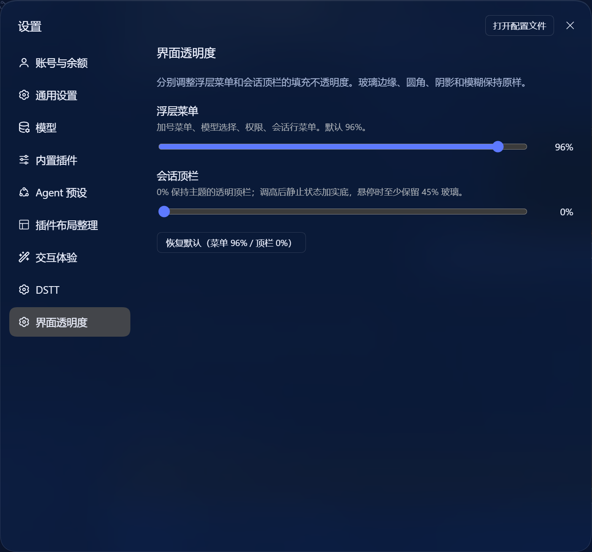
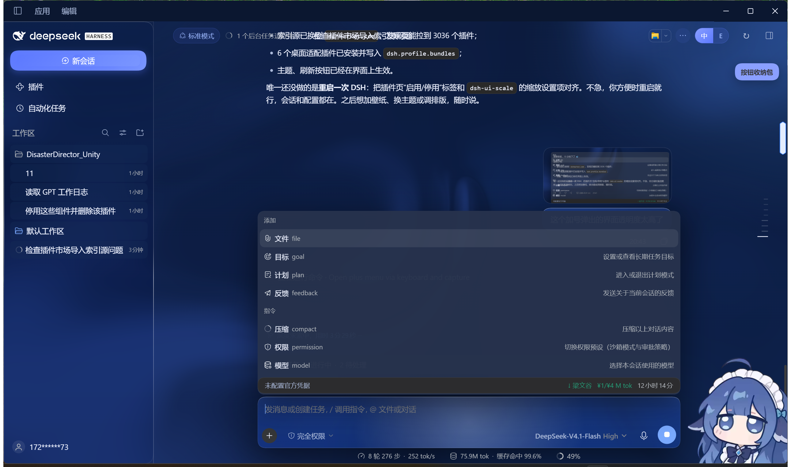

# dsh-menu-opacity

给 [DeepSeek Harness](https://github.com/deepseek-ai/deepseek-harness)（DSH）的**浮层菜单**和**会话顶栏**加透明度控制。

DSH 自带的浮层菜单材质是半透明的（浅色 58% / 深色 45%），深色主题、长对话、背景比较花的时候，加号菜单、模型选择、权限菜单会让背后的文字透上来。会话顶栏则是主题自己画的浮动胶囊：**静止完全透明，悬停才出现 45% 玻璃**。

这个插件把这两层分开做成两个滑杆，只改填充，保留玻璃边缘、圆角、阴影和模糊。



## 功能

- **设置 → 界面透明度**
  - **浮层菜单**：40%–100%，默认 96%
  - **会话顶栏**：0%–100%，默认 0%（保持主题的透明观感）
- 深浅色分别取色：
  - 菜单：浅色 `rgb(248 249 250 / α)`，深色 `rgb(39 50 76 / α)`
  - 顶栏：浅色 `rgb(255 255 255 / α)`，深色 `rgb(13 30 60 / α)`
- 顶栏悬停至少保留 45% 玻璃；调到 0% 时行为与主题完全一致
- 选择保存在本地（localStorage），重启后保留
- 纯客户端：无宿主代码、无网络请求、无外部依赖、不写产品文件

菜单层效果：



## 安装

### 桌面版（推荐）

1. 打开 **插件 → 添加插件 → 安装第三方插件**
2. 选择本目录（或填入绝对路径），安装并启用
3. 重启或刷新 DSH

> 桌面版的 `desktop` profile 由 Electron 应用独占管理，`dsh plugin` CLI 会直接拒绝；请走应用内的插件安装入口。

### dsh web

```bash
dsh plugin --profile <profile> add -w /absolute/path/to/dsh-menu-opacity
```

### 从 Git 安装

```bash
dsh plugin --profile <profile> add github:lzxvic/dsh-menu-opacity
```

## 使用

打开 **设置 → 界面透明度**：

- **浮层菜单**：96% 接近不透明；70% 左右还能看到一点背景；40% 接近产品原始的半透明程度
- **会话顶栏**：0% 保持主题的透明顶栏；调高后静止状态出现实底，悬停时取 `max(滑杆值, 45%)`，不会比主题原来的玻璃更透
- **恢复默认**：菜单 96%、顶栏 0%

## 原理

### 浮层菜单

DSH 的菜单材质使用 `--dsw-menu-surface-fill`（深色/浅色各一套默认值）。插件注入更高优先级的规则：

```css
html:root {
  --dsw-menu-surface-fill: rgb(248 249 250 / var(--dsh-menu-alpha, .96)) !important;
}
html body[data-ds-dark-theme],
html body[data-dshome-dark] {
  --dsw-menu-surface-fill: rgb(39 50 76 / var(--dsh-menu-alpha, .96)) !important;
}
```

### 会话顶栏

主题用 `:has(> [class*="_headerLeading"]):has([class*="_headerActions"])::before` 画顶栏胶囊：

- 静止：`background: transparent`
- 悬停：`rgba(255,255,255,.45)`（深色 `rgba(13,30,60,.45)`）+ `blur(20px)`

插件只覆盖这个 `::before` 的背景：

```css
html body :has(> [class*="_headerLeading"]):has([class*="_headerActions"])::before {
  background: rgb(13 30 60 / var(--dsh-header-alpha, 0)) !important;
}
html body :has(> [class*="_headerLeading"]):has([class*="_headerActions"]):hover::before {
  background: rgb(13 30 60 / var(--dsh-header-hover-alpha, .45)) !important;
}
```

`--dsh-header-hover-alpha` 由脚本取 `max(滑杆值, 45%)`。没有改 DOM、没有改产品样式表。

## 兼容性

- 测试于 **DSH 0.2.1-rc.2**（Windows 桌面版）
- Web 版同理；浅色 / 深色都覆盖
- 与主题插件共存：只改菜单填充和顶栏背景，不动玻璃边框、阴影、模糊
- 顶栏选择器使用主题的 `_headerLeading` / `_headerActions` 语义锚点，不依赖构建哈希

## 开发

```bash
git clone https://github.com/lzxvic/dsh-menu-opacity.git
cd dsh-menu-opacity

# 链接到 profile（桌面版请在应用内安装）
dsh plugin --profile <profile> add -w "$PWD"
```

改 `lib/client.js` 后刷新客户端即可。设置分区通过 `slots.inject('settings.section')` 注册，样式通过一条 `<style data-dsh-menu-opacity>` 注入。

```
dsh-menu-opacity/
├─ package.json
├─ cordis.patch.yml
├─ dsh.plugin.json
├─ docs/
│  ├─ settings.png
│  └─ menu.png
└─ lib/
   ├─ index.js      # host 空实现
   └─ client.js     # 设置分区 + 两个滑杆 + CSS 变量
```

## License

MIT。见 [LICENSE](LICENSE)。

## English

A small DSH plugin that adds two opacity sliders under **Settings → Interface opacity**:

- **Popup menus** (40–100%, default 96%) — fixes the product's 58%/45% menu fill so chat text no longer bleeds through the composer "+" menu.
- **Session header** (0–100%, default 0%) — keeps the theme's transparent floating header at 0%; raising it adds a resting fill while hover never drops below the theme's 45% glass.

Client-only, persisted in localStorage. Tested with DSH 0.2.1-rc.2 on Windows desktop. Not affiliated with DeepSeek.
